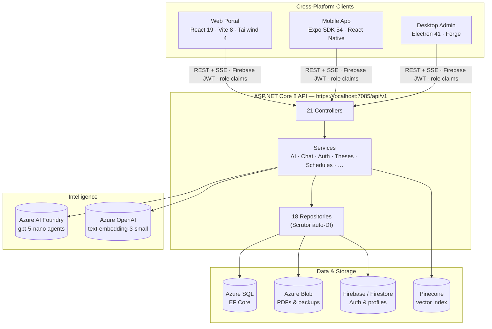
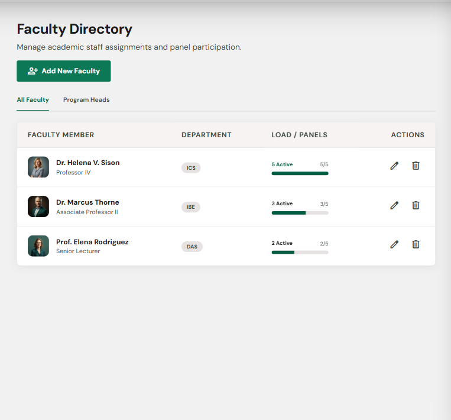

# MonteAI — MonteSkolar

[](https://dotnet.microsoft.com/)
[](https://learn.microsoft.com/aspnet/core/)
[](https://react.dev/)
[](https://vitejs.dev/)
[](https://expo.dev/)
[](https://www.electronjs.org/)
[](https://www.typescriptlang.org/)
[](https://pnpm.io/)

[](https://github.com/Capstone-Collaboration-Group/MonteAI/stargazers)
[](https://github.com/Capstone-Collaboration-Group/MonteAI/network/members)
[](https://github.com/Capstone-Collaboration-Group/MonteAI/issues)
[](https://github.com/Capstone-Collaboration-Group/MonteAI/commits/dev)
[](https://github.com/Capstone-Collaboration-Group/MonteAI/tree/dev)
[](https://monte-skolar.vercel.app)

**MonteAI** (product name *MonteSkolar*) is an AI-powered research assistant and digital thesis repository for **Colegio de Montalban**. It lets students and faculty search, browse, and converse with a curated collection of theses and capstone studies through a **Retrieval-Augmented Generation (RAG)** agent with source citations — while admins manage submissions, users, defense scheduling, and knowledge-base ingestion from a desktop control panel.

> Capstone project requirement under the CHED memorandum of Colegio de Montalban, in collaboration with the institution's digital repository of published theses and capstone studies.

[Overview](#overview) • [Features](#features) • [Statistics](#system-at-a-glance) • [Architecture](#architecture) • [Tech Stack](#technology-stack) • [Quick Start](#development-setup) • [Docs](#documentation)

---

## Overview

| | |
|---|---|
| **Audience** | Students, Faculty, Program Heads, and Admins of Colegio de Montalban |
| **Core capability** | Agentic RAG chat over indexed thesis metadata with numbered citations and SSE streaming |
| **Three clients** | Public web portal, Expo mobile companion, Electron admin panel — over one unified API |
| **Auth** | Firebase ID tokens with per-request role claims, TOTP two-factor authentication + recovery codes |
| **Cloud services** | Azure SQL, Azure Blob Storage, Azure OpenAI / AI Foundry, Pinecone vector DB, Firebase, Firestore |

**What it does:**

- **Thesis lifecycle** — students submit and revise theses with group gates; reviewers and admins approve, reject, or request revisions; approval triggers indexing into the vector store.
- **RAG-powered research chat** — a planner/synthesizer agent pipeline (Azure AI Foundry `gpt-5-nano`) retrieves via semantic search, keyword search, and thesis metadata tools, then answers strictly from repository content with citations.
- **Defense scheduling** — admins and program heads create defense schedules, assign panelists, and view them on a shared calendar (web + desktop + mobile).
- **Repository & community** — announcements, research groups with advisers, notifications, proceedings, analytics, and activity logs.
- **Hardened access control** — four roles (Student, Faculty, Program Head, Admin), rate limiting, query moderation, semantic answer caching, and background email/backup workers.

## Features

### Web Portal (`apps/web`)
Public portal and chat client — landing page, thesis browsing & viewer (PDF), RAG chat with streaming answers and citations, submission flow, schedules, announcements, research groups, settings, and TOTP security settings.

### Mobile (`apps/mobile`)
Expo (SDK 54) student companion with file-based routing — tabbed home, chat, library, schedules, announcements, research groups, and profile; plus auth flows (login, sign-up, forgot password), notifications, and thesis submission.

### Desktop Admin (`apps/desktop`)
Electron + Forge control panel — dashboard, user/faculty management, thesis review & viewer, schedules, panelist assignments, research groups, announcements, and one-click **approve/reindex** that triggers server-side vector ingestion.

### Backend (`server`)
ASP.NET Core 8 Web API — 21 controllers covering auth, chat, search, theses, submissions, reviews, schedules, panelists, announcements, analytics, backups, notifications, and more. Layered **Controllers → Services → Repositories** architecture with Scrutor auto-DI, EF Core + migrations, Serilog logging, Swagger, rate limiting, and a Dockerfile.

### RAG Pipeline (`server/Services/AI`)
- **Ingestion** — metadata-only vectors (`thesis_{id}_meta`): the server resolves authors/year/abstract, embeds with `text-embedding-3-small`, and upserts to Pinecone; legacy full-text chunk purge and re-ingest ops runners included.
- **Chat** — planner + synthesizer agents routed by `LlmClientPool` over Azure AI Foundry deployments, with APA citation formatting, query moderation, topic queries, and a deterministic fallback responder.
- **Ops tooling** — `--diagnose-index`, `--reingest-all`, `--repair-abstracts`, and `--purge-fulltext` runners for index health; prompt regression check via `--prompt-check`.

## System at a Glance

| Metric | Value | Metric | Value |
|---|---:|---|---:|
| Lines of code (C# / TS / TSX) | **≈ 79,000** | Tracked source files | **762** |
| API controllers | **21** | Backend services | **75** |
| Repositories | **18** |  EF Core migrations | **39** |
| Web pages | **15** |  Desktop panel pages | **12** |
| Mobile routes | **26** | Shared workspace packages | **5** |
| Documentation files | **15** | Roles | **4** |

| Codebase | Lines | Focus |
|---|---:|---|
| `server/` (C#) | ≈ 33,900 | API, RAG pipeline, infrastructure |
| `packages/` (TS) | ≈ 25,000 | Shared API client, types, hooks, UI, utils |
| `apps/mobile/` (TSX) | ≈ 6,300 | Expo student companion |
| `apps/web/` (TSX) | ≈ 5,000 | Public portal + chat |
| `apps/desktop/` (TSX) | ≈ 2,200 | Electron admin panel |

> Repository statistics are measured from the working tree (`.cs` / `.ts` / `.tsx`, excluding build output). Stars / forks / issues badges update live from GitHub.

## Architecture



**Request flow (chat):** client → `POST /chat` → query moderation → embed query → Pinecone retrieval (semantic + keyword + metadata tools) → agent planner/synthesizer over grounded context → streamed answer with numbered citations → semantic answer cache.

## Technology Stack

### Backend
| Layer | Technology |
|---|---|
| Framework | ASP.NET Core 8 (Web API), Swagger, Docker support |
| ORM / DB | Entity Framework Core → Azure SQL |
| Auth | Firebase Admin SDK, JWT Bearer, **Otp.NET (TOTP 2FA)**, role claims |
| Vector search | Pinecone (`Pinecone.Client`) — metadata-only thesis index |
| LLM | Azure OpenAI (`text-embedding-3-small`), Azure AI Foundry agents (`gpt-5-nano`) |
| Storage | Azure Blob Storage, Google Cloud Storage / Firestore |
| Cross-cutting | Scrutor (auto-DI), Serilog, Mapster/AutoMapper, rate limiting, MailKit email queue, background workers (backup scheduler, email worker, semantic answer cache) |

### Frontends
| Client | Stack |
|---|---|
| Web | React 19 · Vite 8 · Tailwind CSS 4 · React Router 7 |
| Mobile | Expo SDK 54 · React Native 0.81 · expo-router |
| Desktop | Electron 41 · Electron Forge · Vite · TypeScript 4.5 (pinned) |

### Monorepo (`pnpm` workspace)
| Package | Purpose |
|---|---|
| `@monteai/api` | Typed API services with **live/mock toggle** (`VITE_USE_MOCK`) |
| `@monteai/types` | Shared DTOs, entity types, auth guards |
| `@monteai/hooks` | React Query hooks for chat, theses, schedules, … |
| `@monteai/ui` | Shared components (calendar, defense cards, forms) |
| `@monteai/utils` | Shared helpers |

## Repository Structure

```
MonteAI/
├── apps/
│   ├── web/                  # React + Vite public portal & chat
│   ├── mobile/               # Expo student companion (file-based routing)
│   └── desktop/              # Electron admin panel (Forge installers)
├── packages/                 # Shared workspace libs (workspace:*)
│   ├── api/  hooks/  types/  ui/  utils/
├── server/                   # ASP.NET Core 8 API (outside pnpm workspace)
│   ├── Controllers/          # 21 API controllers
│   ├── Services/             # Business logic + Services/AI (RAG pipeline)
│   ├── Repositories/         # 18 repositories + interfaces
│   ├── Data/  Migrations/    # AppDbContext + 39 EF migrations
│   ├── Infrastructure/       # LlmClientPool, caches, queues, schedulers
│   ├── Configuration/        # Options: Pinecone, LLM pool, Auth, Email, …
│   ├── server.Tests/         # Test project
│   └── Program.cs  Dockerfile  appsettings*.json
├── docs/                     # PRD, architecture, sitemap, QA reports, guides
├── .github/                  # PR template, Copilot instructions
├── .husky/                   # pre-commit: typecheck · pre-push: lint
├── AGENTS.md                 # Contributor guide for AI agents
├── pnpm-workspace.yaml       # apps/* + packages/* (hoisted linker)
└── package.json              # root scripts (dev:*, build:*, lint, typecheck)
```

## Development Setup

#### Prerequisites
- **Node.js** (Latest LTS) and **pnpm** (`packageManager: pnpm@10.33.2`)
- **.NET 8 SDK** (for the server)
- **Android tooling** for the mobile app (Expo Go app or a prebuilt dev client, `adb`)

#### Quick Start
```bash
git clone -b dev https://github.com/Capstone-Collaboration-Group/MonteAI.git
cd MonteAI
pnpm install
```

#### Run the server
```bash
cd MonteAI
dotnet run --project server
```
- HTTPS profile → `https://localhost:7085`, Swagger at `/swagger`
- Requires gitignored local secrets absent on fresh clones: `server/appsettings.Development.json` (API keys / connection strings) and `server/monteai-firebase-credential.json`
- All frontends target `https://localhost:7085/api/v1` via `VITE_API_BASE_URL`
- Schema changes: `dotnet ef migrations add <Name>` from the repo root

#### TOTP two-factor authentication

Apply the server migration before using authenticator enrollment:

```powershell
dotnet ef database update --project server/server.csproj
```

Configure `Auth:JwtSigningKey` in server user-secrets or the deployment secret
store. It must be a base64-encoded key containing at least 32 random bytes.
For example, generate a value locally with:

```powershell
[Convert]::ToBase64String([Security.Cryptography.RandomNumberGenerator]::GetBytes(32))
```

The API creates an ephemeral signing key only in Development and Testing;
Production requires the configured key. Configure a persistent `DataProtection:KeysPath`
that is shared by API instances and protected at rest so enrolled TOTP secrets
remain decryptable across restarts and deployments. Do not commit signing keys
or Data Protection key-ring files.

Users can enroll, disable, or regenerate recovery codes from account Security
settings in the web, desktop, or mobile app. Enrollment returns one-time
recovery codes; users should save them before leaving the setup screen.

#### Run the clients

**Web**
```bash
cd MonteAI
pnpm dev:web
```

**Mobile**
Ensure that your laptop/pc is connected to the phone.

*Connect to your phone*
1. Enable Developer options in your phone by tapping the build number several times
2. Enable Wireless Debugging
3. Tap *Pair with device with pairing code*
4. In your terminal enter the following command:

```bash
cd MonteAI
adb pair 192.168.100.14:34159   # <- placeholder only, this value is from the IP address & Port
```
You will be prompted to enter the pairing code — enter the Wi-Fi pairing code
and wait for a successful connection.

On your terminal, run:
```bash
cd MonteAI
pnpm dev:mobile
```
You'll see a list of commands:



Press ***a*** to open Android, then wait for the build process.

**Desktop**
```bash
cd MonteAI
pnpm dev:desktop
```

#### All root scripts

| Command | Description |
|---|---|
| `pnpm dev:web` / `dev:mobile` / `dev:desktop` | Run a client in development mode |
| `pnpm dev:android` / `dev:devclient` | Expo dev-client builds (require a prebuilt native client, not Expo Go) |
| `pnpm build:web` | Production build of the web app |
| `pnpm build:desktop` | Build the Electron installer (`make`) |
| `pnpm lint` | Root ESLint + desktop (ESLint 8) + mobile (`expo lint`) |
| `pnpm typecheck` | TypeScript project-wide type checking (also runs on pre-commit) |

> Each app keeps its own gitignored `.env.local`. Set `VITE_USE_MOCK=true` to swap live API services for mocks during development.

## Documentation

| Document | Description |
|---|---|
| [`docs/PROJECT_ARCHITECTURE.md`](docs/PROJECT_ARCHITECTURE.md) | As-built system architecture (v2) — modules, AI pipeline, DB design, API design |
| [`docs/MonteSkolar_PRD.docx`](docs/MonteSkolar_PRD.docx) | Product requirements document |
| [`docs/SITEMAP.md`](docs/SITEMAP.md) | Full workspace/package file map |
| [`docs/AGENT_PIPELINE.md`](docs/AGENT_PIPELINE.md) | RAG agent pipeline details |
| [`docs/MOBILE_WIREFRAMES.md`](docs/MOBILE_WIREFRAMES.md) | Mobile UX wireframes |
| [`docs/TEST_DATA.md`](docs/TEST_DATA.md) · [`docs/THESIS_SAMPLES.md`](docs/THESIS_SAMPLES.md) | Sample data for development |
| [`docs/HEADLESS_QA_REPORT.md`](docs/HEADLESS_QA_REPORT.md) | QA findings |
| [`AGENTS.md`](AGENTS.md) | Contributor guide — commands, conventions, and gotchas |

> Note: `docs/PROJECT_ARCHITECTURE.md` describes an older ONNX-on-desktop pipeline in places — **trust the code over the docs**.

## Contributing

- The shared branch is **`dev`**; feature work happens on `feat/*` branches.
- PR titles must be prefixed `feat:` / `fix:` / `chore:` / `docs:` (see `.github/pull_request_template.md`).
- Husky hooks: `pre-commit` runs `pnpm typecheck`; `pre-push` runs `pnpm lint`.
- All credentials live only in gitignored local files (`.env.local`, `appsettings.Development.json`, `monteai-firebase-credential.json`) — **never commit them**.

---

<p align="center">
  <sub>Colegio de Montalban · Capstone Collaboration Group · <a href="https://monte-skolar.vercel.app">monte-skolar.vercel.app</a></sub>
</p>
